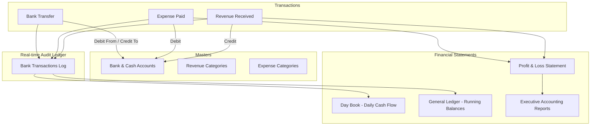

# Accounting Module: Architecture, Workflows & Implementation Prompt

> **Prompt Purpose:** Use this document as a master prompt and technical specification to build a complete, robust, double-entry-ready **Accounting Module** in any Laravel / web application project.

---

## 1. System Role & Persona

You are an expert Principal Software Architect and Senior Laravel Engineer. You are tasked with implementing a production-grade, multi-account **Accounting Module** tailored for financial enterprises, chit funds, lending institutions, or general ERP systems. 

Follow standard accounting principles:
- Every monetary inflow increases a selected cash/bank account and is recorded as **Credit / Revenue**.
- Every monetary outflow decreases a selected cash/bank account and is recorded as **Debit / Expense**.
- Transfers between accounts credit the source and debit the destination atomically via database transactions.
- All transactions feed in real time into the **Day Book**, **Account Ledger**, and **Profit & Loss (P&L)** statements.

---

## 2. Menu Navigation & Submenu Breakdown

The module contains **12 primary submenus** organized under the top-level **Accounting** menu:

| # | Menu Item | Route Name | Purpose |
|---|---|---|---|
| 1 | **Dashboard** | `account.index` | Overview of liquidity, cash vs bank balance, income vs expenses, and recent financial activity. |
| 2 | **Bank Accounts** | `account.bank-accounts.index` | Manage bank accounts, cash registers, petty cash, card accounts, and their balances. |
| 3 | **Bank Transfers** | `account.bank-transfers.index` | Internal fund transfers between company bank/cash accounts with fee tracking. |
| 4 | **Bank Transactions** | `account.bank-transactions.index` | Chronological audit trail of all deposits, withdrawals, and transfers with reconciliation. |
| 5 | **Revenues** | `account.revenues.index` | Record incoming money (fees, collections, interest, commissions, investments). |
| 6 | **Expenses** | `account.expenses.index` | Record outgoing money (rent, salaries, utility bills, maintenance, vendor payouts). |
| 7 | **Day Book** | `account.day-book.index` | Single-day chronological log of all cash/bank inflows, outflows, opening balance, and closing balance. |
| 8 | **Ledger** | `account.ledger.index` | Account-wise or Category-wise general ledger showing opening balance, debits, credits, and running balance. |
| 9 | **Profit & Loss** | `account.profit-loss.index` | Income statement for any date range: Total Revenues minus Total Expenses = Net Profit / Loss. |
| 10 | **Revenue Categories** | `account.revenue-categories.index` | Masters for categorizing income streams (e.g., Interest Income, Processing Fees, Penalties). |
| 11 | **Expense Categories** | `account.expense-categories.index` | Masters for categorizing expenditures (e.g., Office Rent, Salaries, IT & Software, Legal Fees). |
| 12 | **Reports** | `account.reports.index` | Executive reporting suite (Trial Balance, Cash Flow, Category Breakdowns, Balance Sheet). |

---

## 3. Core Database Schema & Migrations

### 3.1. `bank_accounts`
Stores bank accounts, cash desks, and digital wallets.
```sql
CREATE TABLE `bank_accounts` (
  `id` BIGINT UNSIGNED AUTO_INCREMENT PRIMARY KEY,
  `bank_name` VARCHAR(191) NOT NULL,
  `account_number` VARCHAR(100) NOT NULL UNIQUE,
  `holder_name` VARCHAR(191) NOT NULL,
  `branch_name` VARCHAR(191) NULL,
  `ifsc_code` VARCHAR(50) NULL,
  `account_type` ENUM('savings', 'current', 'cash', 'overdraft') DEFAULT 'current',
  `opening_balance` DECIMAL(15,2) NOT NULL DEFAULT 0.00,
  `current_balance` DECIMAL(15,2) NOT NULL DEFAULT 0.00,
  `contact_number` VARCHAR(50) NULL,
  `bank_address` TEXT NULL,
  `status` ENUM('active', 'inactive') DEFAULT 'active',
  `created_at` TIMESTAMP NULL,
  `updated_at` TIMESTAMP NULL,
  `deleted_at` TIMESTAMP NULL
);
```

### 3.2. `revenue_categories` & `expense_categories`
Category masters for classification and P&L aggregation.
```sql
CREATE TABLE `revenue_categories` (
  `id` BIGINT UNSIGNED AUTO_INCREMENT PRIMARY KEY,
  `name` VARCHAR(191) NOT NULL,
  `code` VARCHAR(50) NULL UNIQUE,
  `description` TEXT NULL,
  `status` ENUM('active', 'inactive') DEFAULT 'active',
  `created_at` TIMESTAMP NULL,
  `updated_at` TIMESTAMP NULL,
  `deleted_at` TIMESTAMP NULL
);

CREATE TABLE `expense_categories` (
  `id` BIGINT UNSIGNED AUTO_INCREMENT PRIMARY KEY,
  `name` VARCHAR(191) NOT NULL,
  `code` VARCHAR(50) NULL UNIQUE,
  `description` TEXT NULL,
  `status` ENUM('active', 'inactive') DEFAULT 'active',
  `created_at` TIMESTAMP NULL,
  `updated_at` TIMESTAMP NULL,
  `deleted_at` TIMESTAMP NULL
);
```

### 3.3. `revenues`
Tracks all income received.
```sql
CREATE TABLE `revenues` (
  `id` BIGINT UNSIGNED AUTO_INCREMENT PRIMARY KEY,
  `voucher_no` VARCHAR(100) NOT NULL UNIQUE,
  `revenue_category_id` BIGINT UNSIGNED NOT NULL,
  `bank_account_id` BIGINT UNSIGNED NOT NULL,
  `amount` DECIMAL(15,2) NOT NULL,
  `date` DATE NOT NULL,
  `payer_name` VARCHAR(191) NULL,
  `client_id` BIGINT UNSIGNED NULL,
  `payment_method` ENUM('cash', 'cheque', 'neft', 'rtgs', 'upi', 'card') DEFAULT 'cash',
  `reference_no` VARCHAR(100) NULL,
  `description` TEXT NULL,
  `attachment` VARCHAR(255) NULL,
  `status` ENUM('pending', 'approved', 'posted', 'cancelled') DEFAULT 'posted',
  `created_by` BIGINT UNSIGNED NULL,
  `created_at` TIMESTAMP NULL,
  `updated_at` TIMESTAMP NULL,
  `deleted_at` TIMESTAMP NULL,
  FOREIGN KEY (`revenue_category_id`) REFERENCES `revenue_categories`(`id`) ON DELETE RESTRICT,
  FOREIGN KEY (`bank_account_id`) REFERENCES `bank_accounts`(`id`) ON DELETE RESTRICT
);
```

### 3.4. `expenses`
Tracks all expenditures.
```sql
CREATE TABLE `expenses` (
  `id` BIGINT UNSIGNED AUTO_INCREMENT PRIMARY KEY,
  `voucher_no` VARCHAR(100) NOT NULL UNIQUE,
  `expense_category_id` BIGINT UNSIGNED NOT NULL,
  `bank_account_id` BIGINT UNSIGNED NOT NULL,
  `amount` DECIMAL(15,2) NOT NULL,
  `date` DATE NOT NULL,
  `payee_name` VARCHAR(191) NULL,
  `payment_method` ENUM('cash', 'cheque', 'neft', 'rtgs', 'upi', 'card') DEFAULT 'cash',
  `reference_no` VARCHAR(100) NULL,
  `description` TEXT NULL,
  `attachment` VARCHAR(255) NULL,
  `status` ENUM('pending', 'approved', 'posted', 'cancelled') DEFAULT 'posted',
  `created_by` BIGINT UNSIGNED NULL,
  `created_at` TIMESTAMP NULL,
  `updated_at` TIMESTAMP NULL,
  `deleted_at` TIMESTAMP NULL,
  FOREIGN KEY (`expense_category_id`) REFERENCES `expense_categories`(`id`) ON DELETE RESTRICT,
  FOREIGN KEY (`bank_account_id`) REFERENCES `bank_accounts`(`id`) ON DELETE RESTRICT
);
```

### 3.5. `bank_transfers`
Tracks movement of funds between internal accounts.
```sql
CREATE TABLE `bank_transfers` (
  `id` BIGINT UNSIGNED AUTO_INCREMENT PRIMARY KEY,
  `transfer_no` VARCHAR(100) NOT NULL UNIQUE,
  `from_account_id` BIGINT UNSIGNED NOT NULL,
  `to_account_id` BIGINT UNSIGNED NOT NULL,
  `amount` DECIMAL(15,2) NOT NULL,
  `transfer_fee` DECIMAL(15,2) NOT NULL DEFAULT 0.00,
  `date` DATE NOT NULL,
  `payment_method` ENUM('cash', 'cheque', 'neft', 'rtgs', 'upi', 'internal') DEFAULT 'internal',
  `reference_no` VARCHAR(100) NULL,
  `description` TEXT NULL,
  `status` ENUM('pending', 'completed', 'cancelled') DEFAULT 'completed',
  `created_by` BIGINT UNSIGNED NULL,
  `created_at` TIMESTAMP NULL,
  `updated_at` TIMESTAMP NULL,
  `deleted_at` TIMESTAMP NULL,
  FOREIGN KEY (`from_account_id`) REFERENCES `bank_accounts`(`id`) ON DELETE RESTRICT,
  FOREIGN KEY (`to_account_id`) REFERENCES `bank_accounts`(`id`) ON DELETE RESTRICT
);
```

### 3.6. `bank_transactions` (The Universal Bank Ledger)
Every event touching a bank/cash account creates an immutable transaction entry.
```sql
CREATE TABLE `bank_transactions` (
  `id` BIGINT UNSIGNED AUTO_INCREMENT PRIMARY KEY,
  `bank_account_id` BIGINT UNSIGNED NOT NULL,
  `transaction_date` DATE NOT NULL,
  `type` ENUM('credit', 'debit') NOT NULL,
  `amount` DECIMAL(15,2) NOT NULL,
  `balance_after` DECIMAL(15,2) NOT NULL,
  `source_type` VARCHAR(100) NOT NULL, -- 'revenue', 'expense', 'transfer_out', 'transfer_in', 'loan_collection', 'loan_disbursement'
  `source_id` BIGINT UNSIGNED NULL,
  `reference_no` VARCHAR(100) NULL,
  `description` TEXT NULL,
  `is_reconciled` BOOLEAN DEFAULT FALSE,
  `reconciled_at` TIMESTAMP NULL,
  `created_at` TIMESTAMP NULL,
  `updated_at` TIMESTAMP NULL,
  FOREIGN KEY (`bank_account_id`) REFERENCES `bank_accounts`(`id`) ON DELETE CASCADE
);
```

---

## 4. End-to-End Accounting Workflow



---

## 5. Detailed Step-by-Step Submenu Logic

### 1. Dashboard (`account.index`)
- **Top Metrics:** Total Liquid Cash, Total Bank Balance, Today's Inflow (Revenues), Today's Outflow (Expenses), Net Cash Flow.
- **Charts:** Monthly Revenue vs Expense (ApexCharts bar/area), Account Balance Distribution (donut chart).
- **Recent Activity:** Quick table of the latest 10 bank transactions with status tags and vouchers.

### 2. Bank Accounts (`account.bank-accounts`)
- **Operations:** Create, Edit, View, Deactivate.
- **Fields:** Account Holder Name, Bank Name, Account Number, IFSC, Account Type (Savings / Current / Cash), Opening Balance, Contact Number.
- **Rule:** `current_balance` starts as `opening_balance`. Every revenue/credit increments `current_balance`. Every expense/debit decrements `current_balance`.

### 3. Bank Transfers (`account.bank-transfers`)
- **Form Fields:** From Account, To Account, Amount, Transfer Fee (optional), Transfer Date, Payment Method, Reference Number, Description.
- **Atomic Database Transaction:**
  1. Verify `from_account` has balance $\ge (\text{amount} + \text{fee})$.
  2. Deduct `(amount + fee)` from `from_account`.
  3. Add `amount` to `to_account`.
  4. Create two `bank_transactions` entries:
     - `debit` for `from_account` (source: `transfer_out`)
     - `credit` for `to_account` (source: `transfer_in`)
  5. If `transfer_fee > 0`, create an internal expense entry under "Bank Charges".

### 4. Bank Transactions (`account.bank-transactions`)
- **Columns:** Date, Bank Account, Type (`Credit` [Green] / `Debit` [Red]), Amount, Balance After, Reference / Voucher, Description, Reconciled Badge.
- **Features:** Filter by Bank Account, Date Range, Transaction Type; Export to Excel/PDF; Mark Reconciled button.

### 5. Revenues (`account.revenues`)
- **Form Fields:** Voucher No (auto-generated e.g. `REV-2026-0001`), Date, Revenue Category (dropdown), Bank / Cash Account (dropdown), Amount, Payer / Customer Name, Payment Method, Reference/UTR No, Description, File Attachment.
- **Posting Logic:**
  1. Create `revenues` record.
  2. Increase `bank_accounts.current_balance` by `amount`.
  3. Insert into `bank_transactions`: `type = credit`, `source_type = revenue`.
  4. Appears automatically in **Day Book** and **P&L Revenues**.

### 6. Expenses (`account.expenses`)
- **Form Fields:** Voucher No (auto-generated e.g. `EXP-2026-0001`), Date, Expense Category (dropdown), Bank / Cash Account (dropdown), Amount, Payee / Vendor Name, Payment Method, Reference/Bill No, Description, Bill Attachment.
- **Posting Logic:**
  1. Validate `bank_account.current_balance >= amount`.
  2. Create `expenses` record.
  3. Decrease `bank_accounts.current_balance` by `amount`.
  4. Insert into `bank_transactions`: `type = debit`, `source_type = expense`.
  5. Appears automatically in **Day Book** and **P&L Expenses**.

### 7. Day Book (`account.day-book`)
- **Filters:** Date Picker (defaults to Today), Branch / Account (optional).
- **Calculation Formula:**
  $$\text{Closing Balance} = \text{Opening Balance} + \sum \text{Day Inflows} - \sum \text{Day Outflows}$$
- **Sections:**
  - **Opening Balance:** Cumulative net cash/bank balance prior to selected date.
  - **Inflows:** All revenues, loan principal collections, and chit installments received on that date.
  - **Outflows:** All expenses, loan disbursements, and chit prize payouts disbursed on that date.
  - **Closing Balance:** Running net cash/bank balance at the end of the day.

### 8. Ledger (`account.ledger`)
- **Filters:** Account Selector (Bank Account, Revenue Category, or Expense Category), Date Range (From Date &rarr; To Date).
- **Table Columns:** Date, Voucher / Transaction Ref, Description, Debit (₹), Credit (₹), Running Balance (₹).
- **Logic:** Starts with Opening Balance before `From Date`. Chronologically iterates records; Debit increases asset or decreases liability, Credit increases revenue or decreases asset; maintains running balance column.

### 9. Profit & Loss (`account.profit-loss`)
- **Filters:** Date Range (This Month, Last Month, This Quarter, This Financial Year, Custom Range).
- **Structure:**
  - **Revenue (Income):**
    - Grouped by `revenue_categories` with total per category.
    - Subtotal: **Total Operating Revenue** ($R$)
  - **Expenses (Expenditure):**
    - Grouped by `expense_categories` with total per category.
    - Subtotal: **Total Operating Expenses** ($E$)
  - **Net Summary:**
    - $\text{Net Profit / Loss} = R - E$
    - If positive: **Net Profit** (styled in green).
    - If negative: **Net Loss** (styled in red).

### 10. Revenue Categories (`account.revenue-categories`)
- Simple CRUD to manage revenue heads.
- Default Seeds:
  - `Loan Interest Income`
  - `Processing & Documentation Charges`
  - `Chit Company Commission`
  - `Late Payment Penalties`
  - `Consulting & Other Incomes`

### 11. Expense Categories (`account.expense-categories`)
- Simple CRUD to manage expense heads.
- Default Seeds:
  - `Office Rent & Maintenance`
  - `Staff Salaries & Incentives`
  - `Agent Commission Payouts`
  - `Printing & Stationery`
  - `Electricity & Utilities`
  - `Software, Hosting & IT`
  - `Legal & Professional Fees`
  - `Bank Charges & Processing Fees`

### 12. Reports (`account.reports`)
Consolidated financial report suite with quick links and print/export:
1. **Trial Balance:** Lists Debit vs Credit balances across all accounts; proves mathematical accuracy ($\sum \text{Debits} = \sum \text{Credits}$).
2. **Balance Sheet:** Assets (Bank + Cash + Loans Receivable) vs Liabilities (Deposits + Borrowings) + Equity.
3. **Cash Flow Statement:** Operating, investing, and financing cash flows over time.
4. **Expense Category Breakdown:** Donut and percentage distribution of where money was spent.
5. **Revenue Source Analysis:** Contribution percentage of each revenue stream.

---

## 6. Implementation Service & Controller Pattern

### Universal Posting Service (`AccountingPostingService.php`)
```php
namespace App\Services;

use App\Models\BankAccount;
use App\Models\BankTransaction;
use App\Models\Revenue;
use App\Models\Expense;
use App\Models\BankTransfer;
use Illuminate\Support\Facades\DB;
use Exception;

class AccountingPostingService
{
    public function recordRevenue(array $data): Revenue
    {
        return DB::transaction(function () use ($data) {
            $account = BankAccount::lockForUpdate()->findOrFail($data['bank_account_id']);

            $revenue = Revenue::create($data);

            $account->increment('current_balance', $revenue->amount);

            BankTransaction::create([
                'bank_account_id'  => $account->id,
                'transaction_date' => $revenue->date,
                'type'             => 'credit',
                'amount'           => $revenue->amount,
                'balance_after'    => $account->fresh()->current_balance,
                'source_type'      => 'revenue',
                'source_id'        => $revenue->id,
                'reference_no'     => $revenue->voucher_no,
                'description'      => $revenue->description ?? "Revenue: {$revenue->revenueCategory->name}",
            ]);

            return $revenue;
        });
    }

    public function recordExpense(array $data): Expense
    {
        return DB::transaction(function () use ($data) {
            $account = BankAccount::lockForUpdate()->findOrFail($data['bank_account_id']);

            if ($account->current_balance < $data['amount']) {
                throw new Exception("Insufficient balance in account: {$account->bank_name} ({$account->account_number}).");
            }

            $expense = Expense::create($data);

            $account->decrement('current_balance', $expense->amount);

            BankTransaction::create([
                'bank_account_id'  => $account->id,
                'transaction_date' => $expense->date,
                'type'             => 'debit',
                'amount'           => $expense->amount,
                'balance_after'    => $account->fresh()->current_balance,
                'source_type'      => 'expense',
                'source_id'        => $expense->id,
                'reference_no'     => $expense->voucher_no,
                'description'      => $expense->description ?? "Expense: {$expense->expenseCategory->name}",
            ]);

            return $expense;
        });
    }

    public function executeBankTransfer(array $data): BankTransfer
    {
        return DB::transaction(function () use ($data) {
            $from = BankAccount::lockForUpdate()->findOrFail($data['from_account_id']);
            $to   = BankAccount::lockForUpdate()->findOrFail($data['to_account_id']);

            $totalDeduction = $data['amount'] + ($data['transfer_fee'] ?? 0);
            if ($from->current_balance < $totalDeduction) {
                throw new Exception("Insufficient balance in source account.");
            }

            $transfer = BankTransfer::create($data);

            $from->decrement('current_balance', $totalDeduction);
            $to->increment('current_balance', $data['amount']);

            // Outflow transaction
            BankTransaction::create([
                'bank_account_id'  => $from->id,
                'transaction_date' => $transfer->date,
                'type'             => 'debit',
                'amount'           => $totalDeduction,
                'balance_after'    => $from->fresh()->current_balance,
                'source_type'      => 'transfer_out',
                'source_id'        => $transfer->id,
                'reference_no'     => $transfer->transfer_no,
                'description'      => "Transfer to {$to->bank_name} ({$to->account_number})",
            ]);

            // Inflow transaction
            BankTransaction::create([
                'bank_account_id'  => $to->id,
                'transaction_date' => $transfer->date,
                'type'             => 'credit',
                'amount'           => $data['amount'],
                'balance_after'    => $to->fresh()->current_balance,
                'source_type'      => 'transfer_in',
                'source_id'        => $transfer->id,
                'reference_no'     => $transfer->transfer_no,
                'description'      => "Transfer from {$from->bank_name} ({$from->account_number})",
            ]);

            return $transfer;
        });
    }
}
```

---

## 7. Execution Checklist for New Projects

1. **Migrations:** Create and run tables in order: `bank_accounts`, `revenue_categories`, `expense_categories`, `revenues`, `expenses`, `bank_transfers`, `bank_transactions`.
2. **Seeders:** Seed initial default revenue and expense categories.
3. **Service Layer:** Implement `AccountingPostingService` with atomic database transactions.
4. **Controllers & Routes:**
   - Register routes under prefix `account` with `auth` and role protection (`admin`).
   - Implement controllers for each of the 12 submenus.
5. **Views / UI:**
   - Use DataTables or responsive Bootstrap tables with search, date range filters, and export buttons (CSV / PDF / Print).
   - Add modals for Quick Add Revenue, Quick Add Expense, and Quick Transfer.
6. **Integrations:**
   - Hook Loan EMI collections and Chit subscription receipts to trigger `recordRevenue()`.
   - Hook Loan disbursements and Chit prize bid payouts to trigger `recordExpense()`.
