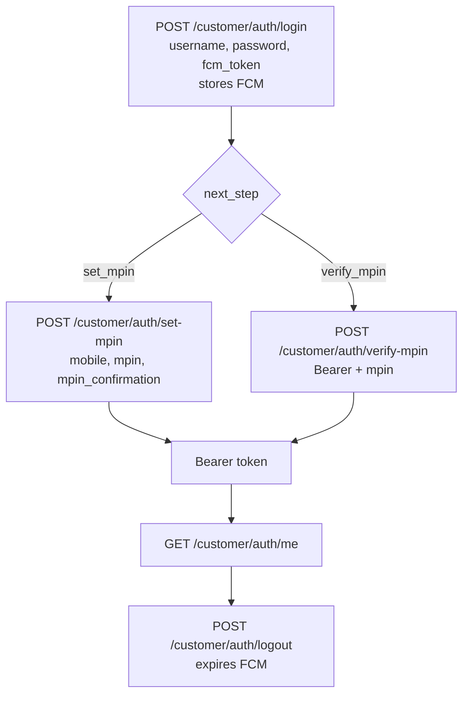
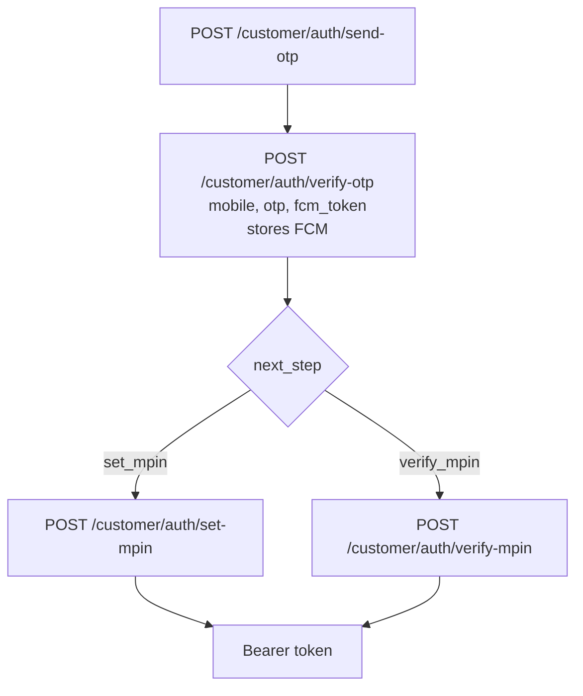

# Customer Auth API — Workflow

Base URL: `{{base_url}}/api`  
Example: `http://localhost/financeandchitfund/public/api`

Related: [Customer_Auth_API_Manual.md](./Customer_Auth_API_Manual.md) · [api_payloads_customer.md](./api_payloads_customer.md) · Postman collection `Customer_Auth_API.postman_collection.json`

There is **no `session_token`**. The app follows `next_step`. The **Bearer token** is issued only on that next step (`set-mpin` / `verify-mpin` / forgot-mpin verify).

---

## Test values

| Key | Value |
|-----|-------|
| mobile | `9876543210` |
| password (default) | same as mobile |
| otp (test phone) | `123456` |
| mpin | `1234` |

**Headers (most requests)**

```
Accept: application/json
Content-Type: application/json
```

**After set/verify MPIN:** copy `token` into `Authorization: Bearer {{token}}`.

---

## FCM token

Send `fcm_token` (or `device_token`) on **first login** (password login or first-time OTP verify). It is **stored immediately**.

| When | What happens | Where |
|------|----------------|-------|
| `POST /login` or first-time `POST /verify-otp` | Store FCM | `users.fcm_token`, `clients.fcm_token`, `user_devices.device_token` |
| `set-mpin` / `verify-mpin` | Issue Bearer token (FCM already stored) | — |
| Logout | Expire / clear FCM | Same three columns |

---

## `next_step` map

| `next_step` | Call next (Bearer is issued here) |
|-------------|-----------------------------------|
| `set_mpin` | `POST /customer/auth/set-mpin` |
| `verify_mpin` | `POST /customer/auth/verify-mpin` |
| `reset_password` | `POST /customer/auth/forgot-password/reset` |
| *(forgot MPIN with mpin)* | Done — response already has `token` |

---

## Flow 1 — Existing user (password + MPIN)



### Step 1 — Login (store FCM)

`POST /api/customer/auth/login`

| Parameter | Required | Example |
|-----------|----------|---------|
| username | Yes* | `9876543210` (mobile **or** email) |
| password | **Yes** | `9876543210` |
| fcm_token | **Yes** (first login / this device) | Firebase token |
| device_id | No | `android-device-001` |
| device_name | No | `Pixel` |
| device_model | No | `Pixel 7` |

```json
{
  "username": "9876543210",
  "password": "9876543210",
  "device_id": "android-device-001",
  "fcm_token": "YOUR_FCM_TOKEN"
}
```

Response (no session_token):

```json
{
  "status": true,
  "message": "Credentials verified. Complete MPIN to continue.",
  "mpin_set": false,
  "next_step": "set_mpin",
  "fcm_stored": true,
  "client": {
    "id": 12,
    "name": "Demo Client",
    "mobile": "9876543210"
  }
}
```

If MPIN already exists, `next_step` is `verify_mpin`.

### Step 2a — First time (`next_step` = `set_mpin`) → Bearer token

`POST /api/customer/auth/set-mpin`

| Parameter | Required | Example |
|-----------|----------|---------|
| mobile | **Yes** | `9876543210` |
| mpin | **Yes** | `1234` |
| mpin_confirmation | **Yes** | `1234` |

```json
{
  "mobile": "9876543210",
  "mpin": "1234",
  "mpin_confirmation": "1234"
}
```

### Step 2b — Next logins / app unlock (`verify_mpin`) → Bearer token

`POST /api/customer/auth/verify-mpin`

Send the stored token. Do **not** send mobile.

```
Authorization: Bearer 6|xxxxxxxxxxxxxxxx
```

```json
{
  "mpin": "1234"
}
```

### Login success (Bearer)

```json
{
  "status": true,
  "message": "Login successful",
  "token_type": "Bearer",
  "token": "6|xxxxxxxxxxxxxxxx",
  "authorization": "Bearer 6|xxxxxxxxxxxxxxxx"
}
```

Use:

```
Authorization: Bearer 6|xxxxxxxxxxxxxxxx
```

Copy the **full** `token` including the number and `|`.

---

## Flow 2 — First-time / new mobile (OTP)



### Step 1 — Send OTP

`POST /api/customer/auth/send-otp`

```json
{
  "mobile": "9876543210",
  "purpose": "first_login"
}
```

### Step 2 — Verify OTP (store FCM)

`POST /api/customer/auth/verify-otp`

| Parameter | Required | Example |
|-----------|----------|---------|
| mobile | **Yes** | `9876543210` |
| otp | **Yes** | `123456` |
| purpose | No | `first_login` |
| fcm_token | **Yes** (this device) | Firebase token |
| device_id | No | `android-device-001` |

```json
{
  "mobile": "9876543210",
  "otp": "123456",
  "purpose": "first_login",
  "fcm_token": "YOUR_FCM_TOKEN",
  "device_id": "android-device-001"
}
```

Then call **set-mpin** or **verify-mpin** with `mobile` + `mpin` only (same as Flow 1). That response has the Bearer `token`.

New OTP-created clients stay `status = pending` until admin verifies KYC.

---

## Flow 3 — Forgot password

1. `POST /api/customer/auth/forgot-password/send-otp` `{ "mobile": "9876543210" }`
2. `POST /api/customer/auth/forgot-password/verify-otp` `{ "mobile": "9876543210", "otp": "123456" }` → `next_step`: `reset_password`
3. `POST /api/customer/auth/forgot-password/reset`

```json
{
  "mobile": "9876543210",
  "password": "newpass123",
  "password_confirmation": "newpass123"
}
```

Then follow `next_step` → `set-mpin` or `verify-mpin` to get the Bearer token.

---

## Flow 4 — Forgot MPIN (one step → Bearer)

1. `POST /api/customer/auth/forgot-mpin/send-otp` `{ "mobile": "9876543210" }`
2. `POST /api/customer/auth/forgot-mpin/verify-otp`

```json
{
  "mobile": "9876543210",
  "otp": "123456",
  "mpin": "1234",
  "mpin_confirmation": "1234",
  "fcm_token": "YOUR_FCM_TOKEN",
  "device_id": "android-device-001"
}
```

Response includes `token`. No extra reset step.

---

## Flow 5 — After Bearer token

**URL (no space):** `{{base_url}}/api/customer/auth/me`

```
Accept: application/json
Authorization: Bearer 6|xxxxxxxxxxxxxxxx
ngrok-skip-browser-warning: 1
```

| Action | Method | URL | Body |
|--------|--------|-----|------|
| Profile | `GET` | `/api/customer/auth/me` | — |
| Change MPIN | `POST` | `/api/customer/auth/change-mpin` | `{ "current_mpin", "mpin", "mpin_confirmation" }` |
| Refresh FCM | `POST` | `/api/users/user/fcm-token` | `{ "fcm_token", "device_id" }` |
| Logout | `POST` | `/api/customer/auth/logout` | `{ "device_id" }` optional |

Logout expires FCM for this device.

---

## Endpoint checklist

| Step | Method | URL | Auth / body |
|------|--------|-----|-------------|
| Login (stores FCM) | POST | `/api/customer/auth/login` | `username`, `password`, `fcm_token` |
| Send OTP | POST | `/api/customer/auth/send-otp` | `mobile` |
| Verify OTP (stores FCM) | POST | `/api/customer/auth/verify-otp` | `mobile`, `otp`, `fcm_token` |
| Set MPIN → **Bearer** | POST | `/api/customer/auth/set-mpin` | `mobile`, `mpin`, `mpin_confirmation` |
| Verify MPIN | POST | `/api/customer/auth/verify-mpin` | Bearer + `{ "mpin" }` |
| Forgot password send OTP | POST | `/api/customer/auth/forgot-password/send-otp` | `mobile` |
| Forgot password verify OTP | POST | `/api/customer/auth/forgot-password/verify-otp` | `mobile`, `otp` |
| Forgot password reset | POST | `/api/customer/auth/forgot-password/reset` | `mobile`, `password`, `password_confirmation` |
| Forgot MPIN send OTP | POST | `/api/customer/auth/forgot-mpin/send-otp` | `mobile` |
| Forgot MPIN verify OTP → **Bearer** | POST | `/api/customer/auth/forgot-mpin/verify-otp` | `mobile`, `otp`, `mpin`, `mpin_confirmation`, `fcm_token` |
| Me | GET | `/api/customer/auth/me` | Bearer |
| Change MPIN | POST | `/api/customer/auth/change-mpin` | Bearer |
| Logout | POST | `/api/customer/auth/logout` | Bearer |
